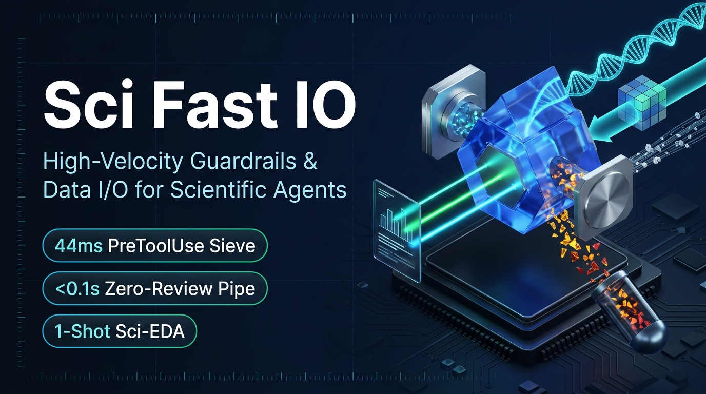
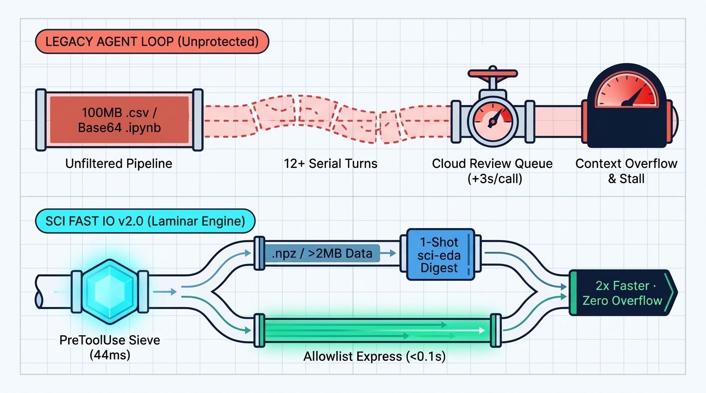
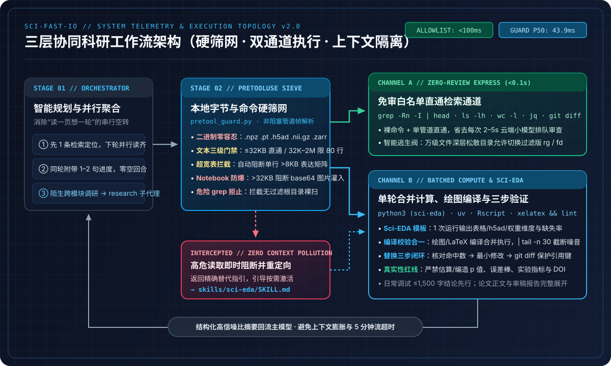

<p align="center">
  
</p>

<h1 align="center">Antigravity Sci Fast IO</h1>

<p align="center">
  <b>English</b> | <a href="./README_zh.md">简体中文</a>
</p>

<p align="center">
  <a href="LICENSE"></a>
  
  <a href="https://www.agensi.io/r/CHEATSAZUKI?to=/bundles/sci-fast-io-pro-scientific-agent-suite"></a>
  
  
  
</p>

**Antigravity Sci Fast IO** (`sci-fast-io`) is a local velocity and context-protection plugin built for **scientific computing, bioinformatics/cheminformatics, deep learning experiments, and LaTeX academic writing** in **Google Antigravity** (inspired by [`oil-oil/agy-fast-io`](https://github.com/oil-oil/agy-fast-io) and re-architected for scientific workflows).

It solves the two biggest bottlenecks of autonomous research agents in one lightweight package: **waiting too long between fragmented tool turns** and **blowing up context windows by accidentally reading multi-megabyte datasets or base64-heavy notebooks**.

> **Using Claude Code, Cursor, GitHub Copilot, Windsurf, or Codex—or need Remote GPU SHA-256 sync gates, frozen paper baselines & LaTeX/PPTX QA?** Jump to [**Community MIT vs. Sci-Fast-IO Pro (Cross-Agent Suite)**](#community-mit-vs-sci-fast-io-pro-cross-agent-suite).

---

## Why Do Scientific Workflows Need Dedicated Guardrails?

<p align="center">
  
</p>

When running heavy reasoning models (such as Gemini 4 Carbon / Argon) on research repositories with default settings, wall-clock time and context budget are silently drained by four patterns:

1. **Fragmented Multi-Turn File Reads**: Searching -> thinking 30s -> reading 50 lines -> reading another 50 lines across a dozen turns eats minutes of reasoning latency.
2. **Desktop Cloud-Review Queueing**: Non-allowlisted shell commands (`rg`, `find`, or commands chaining `&&`, `;`, `cd`, `2>/dev/null`) trigger a **2–5s** secondary cloud safety check on every invocation in Antigravity Desktop.
3. **Dataset & `.ipynb` Context Explosions**: Research folders mix 500 MB `.csv` / `.vcf` / `.fastq` tables, binary weights (`.npz`, `.pt`, `.h5ad`, `.safetensors`, `.nii.gz`), and `.ipynb` notebooks packed with single-line base64 plots. One accidental `read_file` or unfiltered `grep -rn .` stalls or ruins the entire session.
4. **Piecemeal EDA Trial-and-Error**: Splitting dataset inspection into five separate `python3 -c` calls for `shape`, columns, missingness, and summary stats multiplies model thinking + command approval overhead.

---

## What Does Sci Fast IO v2.0 Do? (Community Edition — Free & MIT)

<p align="center">
  
</p>

v2.0 combines **a `<50ms` local `PreToolUse` gate + high-signal standing rules + on-demand EDA templates**:

### 1. Sub-50ms Local `PreToolUse` Gate (`pretool_guard.py`, ~44ms median)
Pure Python 3.9+ standard library (zero pip dependencies; non-blocking pipe parser; supports both `read_file` and `view_file`):
- **Zero-Tolerance Binary & Archive Block**: Blocks raw text reads on `.parquet`, `.feather`, `.npz`, `.npy`, `.pt`, `.ckpt`, `.safetensors`, `.h5`, `.h5ad`, `.rds`, `.bam`, `.nii.gz`, `.fastq.gz`, `.vcf.gz`, `.zarr` directories, and symlinks to binaries.
- **Tiered Scientific Text Gate**:
  - `<= 32 KiB` (e.g., `metrics.csv`): **Allowed immediately** with zero friction;
  - `32 KiB – 2 MiB`: Permits bounded reads (`<= 80` lines) while blocking ultra-wide (`> 8 KiB` single-line) gene/feature matrices;
  - `>= 2 MiB`: Blocked with guidance to use allowlisted `head -n 5` or `sci-eda`.
- **Byte-Level `.ipynb` Protection**: Blocks raw full-file reads on notebooks `> 32 KiB` so base64 plots never flood context.
- **Catastrophic `grep` Guard**: Blocks unfiltered root recursive `grep` (`grep -rn '...' .`) and scans targeting `.venv`, `wandb`, or `lightning_logs`.

### 2. Fast-Pass Read Allowlist & Batched Compute Rules (`rules/AGENTS.md`)
- Routes simple read-only inspections through fast-pass allowlisted commands (`ls`, `cat`, `head`, `tail`, `wc`, `grep`, `diff`, `stat`, `du`, `jq`, and read-only `git`), with an efficiency escape hatch to filtered `rg` / `fd` on deep trees.
- Batches EDA stats, `matplotlib` rendering, and `xelatex` / `latexmk` builds into single execution turns with truncated log tails (`| tail -n 30`).
- Enforces 3-step multi-file replacement verification (`\cite{}` safety) and strict scientific numerical integrity (never fabricate `p`-values, error bars, or DOIs/PMIDs).

### 3. On-Demand `sci-eda` Templates (`skills/sci-eda/SKILL.md`)
Progressive-disclosure snippets for inspecting `.parquet`/`.csv`, `.h5ad`/`.zarr`, `.npz`/`.pt`/`.safetensors`, and `.ipynb` cells in one round-trip.

---

## Community MIT vs. Sci-Fast-IO Pro (Cross-Agent Suite)

`antigravity-sci-fast-io` v2.0 remains **100% Free & MIT forever** for Google Antigravity users. For researchers working across **Claude Code, Cursor, GitHub Copilot, Windsurf, Codex & Antigravity** who want standalone Python stdlib CLIs, remote GPU safety, and academic QA hooks, explore the **Sci-Fast-IO Pro** commercial toolkits on [**Agensi.io (`AZUKI` / `@cheat-s-azuki`)**](https://www.agensi.io/r/CHEATSAZUKI?to=/creators/cheat-s-azuki):

| Capability | Community v2.0 (This Repo) | [**Sci-Fast-IO Pro Suite**](https://www.agensi.io/r/CHEATSAZUKI?to=/bundles/sci-fast-io-pro-scientific-agent-suite) |
| :--- | :---: | :---: |
| **License & Price** | **MIT (Free Forever)** | [**$19.99 Suite**](https://www.agensi.io/r/CHEATSAZUKI?to=/bundles/sci-fast-io-pro-scientific-agent-suite) *(60% off)* or **$9.99–$14.99** standalone skills |
| **Supported Coding Agents** | Google Antigravity only | **Claude Code · Cursor · Copilot · Windsurf · Codex · Antigravity** (Local `.zip` + Remote MCP) |
| **Dataset & Tensor Inspection** | Markdown copy-paste snippets | [**Sci-EDA Context Shield**](https://www.agensi.io/r/CHEATSAZUKI?to=/skills/sci-eda-context-shield-for-scientific-data): Standalone `sci_eda_probe.py` CLI (`<6 KiB` cap; stdlib `.safetensors`/`.npy`/`.ipynb`/`.wav`/`.zarr` parsers + `polars`/`h5py`/`torch`) |
| **Remote Cloud GPU Ops & Safe Sync** | — | [**Cloud GPU Experiment Ops**](https://www.agensi.io/r/CHEATSAZUKI?to=/skills/cloud-gpu-experiment-ops-for-runpod-lambda): RunPod, Lambda, Vast.ai, Slurm & AutoDL cache redirect, SSH idle-VRAM probe, `dry-run` `rsync`, **pre-shutdown SHA-256 `GREEN_SAFE_TO_SHUTDOWN` gate** |
| **Anti-Deletion, Frozen Baselines & LaTeX/PPTX QA** | Basic read/grep guard | [**Research Workspace Guardrails**](https://www.agensi.io/r/CHEATSAZUKI?to=/skills/research-workspace-guardrails): Blocks unapproved `rm`/`git clean`, SHA-256 frozen baseline locks, secret-leak guard, LaTeX undefined `\cite{}` + stale PDF checks, `.pptx` font QA & 6-agent `install_hooks.py` |
| **Cross-Agent JSONL Session Search & Repo Distiller** | — | [**Agent Session Ledger**](https://www.agensi.io/r/CHEATSAZUKI?to=/skills/agent-session-ledger-and-repo-distiller): `O(1)` memory `session_ledger.py` (`<8 KiB` digest) across Claude Code, Cursor, Codex & Antigravity + 2-pass repo onboarding |

<p align="center">
  <a href="https://www.agensi.io/r/CHEATSAZUKI?to=/bundles/sci-fast-io-pro-scientific-agent-suite"><b>Get Sci-Fast-IO Pro: Scientific Agent Suite on Agensi.io ($19.99 — Save 60%) →</b></a><br>
  <sub>Also available free on Agensi: <a href="https://www.agensi.io/r/CHEATSAZUKI?to=/skills/antigravity-fast-io-workflow-checklist">Antigravity Fast-IO Workflow Checklist ($0)</a> · 中文文档与跨平台说明请见 <a href="./README_zh.md">简体中文</a></sub>
</p>

---

## Installation & Management (Community MIT Plugin)

### Option 1: Install via `agy` CLI (Recommended)

```bash
git clone https://github.com/youranxiaozhu/antigravity-sci-fast-io.git
agy plugin install antigravity-sci-fast-io/plugin
agy plugin enable sci-fast-io
```

### Option 2: Copy to Global Plugins Directory

```bash
git clone https://github.com/youranxiaozhu/antigravity-sci-fast-io.git
cp -R antigravity-sci-fast-io/plugin ~/.gemini/config/plugins/sci-fast-io
```

> **Tip**: Restart Antigravity Desktop once after initial installation so `hooks.json` and `skills/` activate across all workspaces. Toggle anytime in **Skills & Customizations → Plugins** or via `agy plugin disable sci-fast-io`.

---

## Run Local Automated Tests

Includes 19 zero-dependency regression tests covering tiered byte thresholds, ultra-wide single-line matrices, compound suffixes, `.zarr` directories, symlinks, CJK/space paths, hazardous `grep` patterns, and unclosed `stdin` pipes:

```bash
python3 tests/test_pretool_guard.py
```

---

## Repository Structure

```text
antigravity-sci-fast-io/
├── plugin/                        # Standard Antigravity plugin package
│   ├── plugin.json                # Plugin manifest (v2.0.0)
│   ├── hooks.json                 # PreToolUse local hard gate config
│   ├── scripts/
│   │   └── pretool_guard.py       # Sub-50ms file & command guard script
│   ├── rules/
│   │   └── AGENTS.md              # Standing scientific velocity & integrity rules
│   ├── skills/
│   │   └── sci-eda/SKILL.md       # On-demand single-shot EDA templates
│   └── assets/logo.svg            # Plugin icon
├── assets/readme/                 # README illustrations & architecture SVG
├── tests/test_pretool_guard.py    # 19 automated regression tests
├── README.md                      # English documentation
├── README_zh.md                   # Chinese documentation (简体中文)
└── LICENSE                        # MIT License
```

---

## Credits & License

- The core "fewer round-trips & desktop allowlist fast-pass" philosophy was inspired by [@oil-oil](https://github.com/oil-oil)'s open-source project [`agy-fast-io`](https://github.com/oil-oil/agy-fast-io).
- Released under the [MIT License](LICENSE) by Cheat s (AZUKI) / [@youranxiaozhu](https://github.com/youranxiaozhu).
