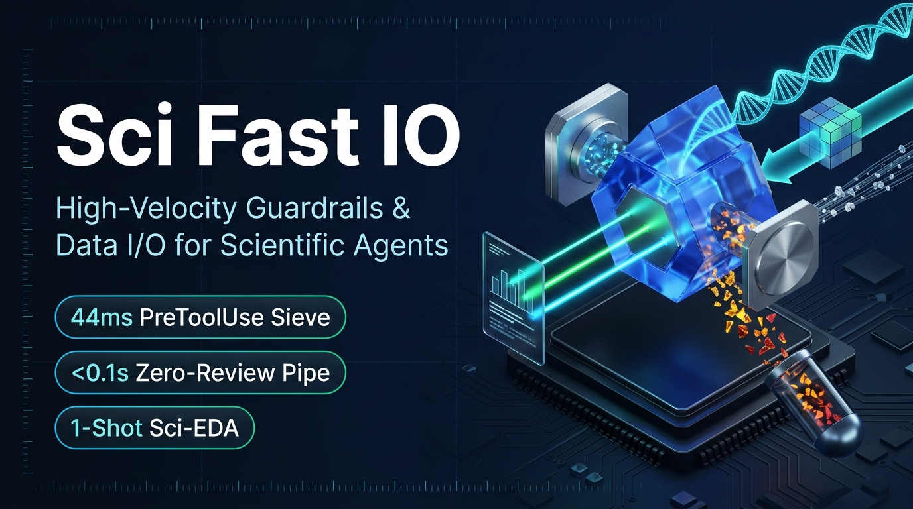
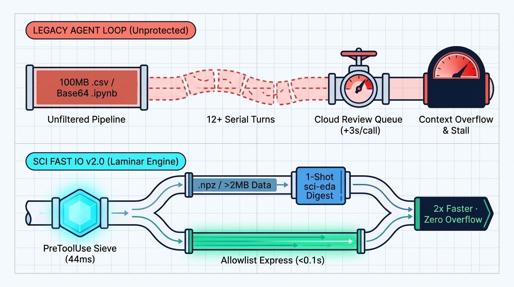
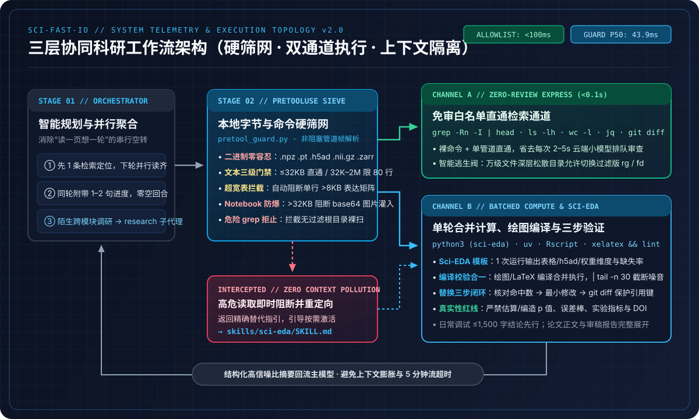

<p align="center">
  
</p>

<h1 align="center">Antigravity Sci Fast IO</h1>

<p align="center">
  <a href="./README.md">English</a> | <b>简体中文</b>
</p>

<p align="center">
  <a href="LICENSE"></a>
  
  <a href="https://www.agensi.io/r/CHEATSAZUKI?to=/bundles/sci-fast-io-pro-scientific-agent-suite"></a>
  
  
  
</p>

**Antigravity Sci Fast IO**（插件 ID：`sci-fast-io`）是专为 **科研计算、生信/化学信息学数据分析、深度学习实验与 LaTeX 学术写作** 打造的 **Google Antigravity** 本地加速与防爆护栏插件（受 [`oil-oil/agy-fast-io`](https://github.com/oil-oil/agy-fast-io) 启发并针对科研场景深度重构）。

它在一个轻量插件包里同时解决科研 Agent 最让人头疼的两件事：**「每步思考等太久」** 与 **「误读大文件瞬间把上下文搞崩」**。

> **同时使用 Claude Code、Cursor、Copilot、Windsurf、Codex，或需要 AutoDL/RunPod 关机对账、防误删冻结基线与 LaTeX/PPTX 自动质检？** 查看下方 [**MIT 开源社区版 vs. Sci-Fast-IO Pro 跨平台专业版对比**](#mit-开源社区版-vs-sci-fast-io-pro-跨平台专业版)。

---

## 为什么科研场景特别需要它？

<p align="center">
  
</p>

在默认配置下使用重度推理模型（如 Gemini 4 Carbon / Argon）跑科研项目，时间往往被以下四处悄悄吃掉：

1. **零碎多轮读文件**：模型习惯“搜一下 → 想 30 秒 → 读一个脚本 50 行 → 不够再补读一轮”，十几个回合下来光等思考就要好几分钟。
2. **桌面端云端审查排队**：Antigravity 2.0 桌面端对白名单外的命令（包括 `rg`、`find`，以及带 `&&`、`;`、`cd`、`2>/dev/null` 的命令）每次都要先发给云端小模型审查，额外排队 **2–5 秒**。
3. **科研大文件与 `.ipynb` 爆仓**：科研目录里常混放着几百 MB 的 `.csv` / `.vcf` / `.fastq`、二进制权重 `.npz` / `.pt` / `.h5ad` / `.nii.gz`，或是嵌满 base64 图片的 `.ipynb`。模型一旦顺手 `read_file` 或对根目录跑 `grep -rn .`，轻则撑爆上下文拖慢后续每一轮推理，重则直接卡死会话。
4. **挤牙膏式 EDA 试探**：查一张表拆成五六次 `python3 -c` 分别看 `shape`、列名、缺失值和统计检验，每次都重复触发“模型思考 + 云端送审”。

---

## Sci Fast IO v2.0（MIT 开源社区版）做了什么？

<p align="center">
  
</p>

v2.0 采用 **「本地毫秒级硬护栏 + 高信噪比常驻规则 + 按需探查模板」** 三层协同架构：

### 1. 本地毫秒级 `PreToolUse` 硬门禁（`pretool_guard.py`，中位耗时 ~44ms）
纯 Python 3.9+ 标准库实现（零第三方依赖，支持未关闭管道非阻塞帧解析，同时兼容桌面端 `read_file` 与 IDE/CLI `view_file`）：
- **二进制与压缩格式零容忍拦截**：精准识别 `.parquet` `.feather` `.npz` `.npy` `.pt` `.ckpt` `.safetensors` `.h5` `.h5ad` `.rds` `.bam`、复合后缀 `.nii.gz` `.fastq.gz` `.vcf.gz`、目录型 `.zarr` 以及指向二进制文件的符号链接。
- **科研文本分级门禁**：
  - `<= 32 KiB`（如实验指标汇总小表 `metrics.csv`）：**直接放行**，零打扰；
  - `32 KiB ~ 2 MiB`：仅允许 `<= 80` 行的显式有界读取，并自动检测阻断单行 `> 8 KiB` 的超宽基因表达矩阵；
  - `>= 2 MiB`：直接拦截并引导使用免审 `head -n 5` 或 `sci-eda`。
- **Notebook 字节级防爆**：废弃不可靠的行数判断，对 `> 32 KiB` 的 `.ipynb` 阻断全文裸读，防止单行巨型 base64 图像灌满上下文。
- **灾难级 `grep` 保守拦截**：精准阻断无过滤的根目录递归扫描（`grep -rn '...' .`）或直扫 `.venv` / `wandb` / `lightning_logs`，绝不擅自篡改复杂 Shell 命令。

### 2. 免审快速通道 + 计算/绘图单轮合并（`rules/AGENTS.md`）
- **只读检索默认走免审白名单**：`ls` `cat` `head` `tail` `wc` `grep` `diff` `stat` `du` `jq` 及长参数只读 `git` 秒级直通（同时保留效率逃生阀：面对万级文件的深层松散目录，允许改用过滤版 `rg` / `fd` 以最小化总耗时）。
- **必审任务合并一次跑完**：EDA 统计、`matplotlib` 绘图、`xelatex` / `latexmk` 编译与产物检查合并为单次执行，并用 `| tail -n 30` 截断宏包刷屏日志。
- **多文件替换三步闭环**：先核对命中数 → 最小范围替换 → `git diff` 复核，保护论文 `\cite{}` 引用键与实验配置安全。
- **日常问答极简，学术写作不缩水**：日常调试控制在 1,500 字以内、结论与指标先行；撰写论文正文、同行评审（Peer Review）与统计报告时按学术标准完整展开，严禁编造或估算 `p` 值、误差棒与文献 DOI/PMID。

### 3. 按需加载 `sci-eda` 标准探查技能（`skills/sci-eda/SKILL.md`）
采用渐进式披露（平时不占主上下文），在探查 `.parquet` / `.csv`、`.h5ad` / `.zarr`、`.npz` / `.pt` / `.safetensors` 或提取大型 `.ipynb` 代码单元时，提供单次即可跑通的标准脚本模板。

---

## MIT 开源社区版 vs. Sci-Fast-IO Pro 跨平台专业版

本仓库 `v2.0` 将**永久保持免费与 MIT 开源**。如果你同时在 **Claude Code、Cursor、GitHub Copilot、Windsurf、Codex 与 Antigravity** 上开展科研，或需要独立可执行的零依赖 CLI 工具集与全生命周期安全护栏，欢迎前往 [**Agensi.io (`AZUKI` / `@cheat-s-azuki`)**](https://www.agensi.io/r/CHEATSAZUKI?to=/creators/cheat-s-azuki) 获取全新重构的 **Sci-Fast-IO Pro 专业版**：

| 核心能力 | MIT 社区版 (本仓库 v2.0) | [**Sci-Fast-IO Pro 跨端专业版**](https://www.agensi.io/r/CHEATSAZUKI?to=/bundles/sci-fast-io-pro-scientific-agent-suite) |
| :--- | :---: | :---: |
| **授权与获取方式** | **MIT 永久免费** | [**Agensi 全家桶 $29.00**](https://www.agensi.io/r/CHEATSAZUKI?to=/bundles/sci-fast-io-pro-scientific-agent-suite)（立省 42%，亦支持 `$9.99–$14.99` 按需选购单模块） |
| **支持平台** | 仅 Google Antigravity | **Claude Code · Cursor · Copilot · Windsurf · Codex · Antigravity** 六端通用（支持本地 `.zip` 与 Remote MCP） |
| **15+ 种科研数据防爆探查** | Markdown 代码片段 | [**Sci-EDA Context Shield**](https://www.agensi.io/r/CHEATSAZUKI?to=/skills/sci-eda-context-shield-for-scientific-data)：独立 `sci_eda_probe.py` CLI（`<6 KiB` 硬上限，无需装 torch 即可纯标准库解析 `.safetensors/.npy/.ipynb/.wav/.zarr`） |
| **AutoDL / RunPod 云端 GPU 运维与关机对账** | — | [**Cloud GPU Experiment Guard**](https://www.agensi.io/r/CHEATSAZUKI?to=/skills/cloud-gpu-experiment-ops-for-runpod-lambda)：AutoDL/SeetaCloud/RunPod/Slurm 数据盘缓存分流、SSH 闲置烧钱告警、默认 `dry-run` 安全 `rsync`、**关机前 SHA-256 `GREEN_SAFE_TO_SHUTDOWN` 对账门禁** |
| **防误删 / 冻结基线 / LaTeX & PPTX 质检** | 基础文件读取与 grep 门禁 | [**Research Workspace Guardrails**](https://www.agensi.io/r/CHEATSAZUKI?to=/skills/research-workspace-guardrails)：拦截未授权 `rm / git clean`、SHA-256 锁定论文冻结基线、防明文私钥泄露、LaTeX 漏引 `\cite{}` 与过期 PDF 检测、PPTX 禁用字体 `Cambria Math` 扫描 + 六端一键 `install_hooks.py` |
| **百兆会话台账检索与仓库快速导读** | — | [**Agent Session Ledger**](https://www.agensi.io/r/CHEATSAZUKI?to=/skills/agent-session-ledger-and-repo-distiller)：`O(1)` 内存流式检索 Claude Code / Cursor / Codex / Antigravity 历史 JSONL（`<8 KiB` 摘要）+ 陌生仓库两轮导读与 SOP 蒸馏 |

<p align="center">
  <a href="https://www.agensi.io/r/CHEATSAZUKI?to=/bundles/sci-fast-io-pro-scientific-agent-suite"><b>前往 Agensi.io 获取 Sci-Fast-IO Pro 跨端科研套件（$29.00 全家桶立省 42%） →</b></a><br>
  <sub>同享免费跨端工作流清单：<a href="https://www.agensi.io/r/CHEATSAZUKI?to=/skills/antigravity-fast-io-workflow-checklist">Antigravity Fast-IO Workflow Checklist ($0)</a></sub>
</p>

---

## 安装与管理（Antigravity MIT 社区版）

### 方式一：使用 `agy` 命令行安装（推荐）

```bash
git clone https://github.com/youranxiaozhu/antigravity-sci-fast-io.git
agy plugin install antigravity-sci-fast-io/plugin
agy plugin enable sci-fast-io
```

### 方式二：手动复制到全局插件目录

```bash
git clone https://github.com/youranxiaozhu/antigravity-sci-fast-io.git
cp -R antigravity-sci-fast-io/plugin ~/.gemini/config/plugins/sci-fast-io
```

> **提示**：首次安装包含 `hooks.json` 和 `skills/` 的插件后，重启一次 Antigravity 桌面端即可在所有工作区全面激活。日常开关可在左侧 **Skills & Customizations → Plugins** 面板一键切换，或运行 `agy plugin disable sci-fast-io`。

---

## 本地运行测试

仓库内置 19 项无外部依赖的自动化回归测试（覆盖分级体积阈值、超宽单行表、复合后缀、`.zarr` 目录、符号链接、中文/空格路径、危险 `grep` 识别及未关闭 `stdin` 管道压力测试）：

```bash
python3 tests/test_pretool_guard.py
```

---

## 仓库目录结构

```text
antigravity-sci-fast-io/
├── plugin/                        # Antigravity 标准插件包
│   ├── plugin.json                # 插件元数据 (v2.0.0)
│   ├── hooks.json                 # PreToolUse 本地硬门禁配置
│   ├── scripts/
│   │   └── pretool_guard.py       # 毫秒级文件与命令守卫脚本
│   ├── rules/
│   │   └── AGENTS.md              # 常驻科研加速与真实性规则
│   ├── skills/
│   │   └── sci-eda/SKILL.md       # 按需科研数据单次探查模板库
│   └── assets/logo.svg            # 插件图标
├── assets/readme/                 # README 插画与矢量架构图
├── tests/test_pretool_guard.py    # 19 项自动化回归测试套件
├── README.md                      # 英文版说明文档 (English)
├── README_zh.md                   # 中文版说明文档 (简体中文)
└── LICENSE                        # MIT 许可证
```

---

## 致谢与许可

- 核心“少走回合、免审白名单直通”思路源自 [@oil-oil](https://github.com/oil-oil) 的优秀开源项目 [`agy-fast-io`](https://github.com/oil-oil/agy-fast-io)。
- 本项目采用 [MIT License](LICENSE) 开源（作者：Cheat s (AZUKI) / [@youranxiaozhu](https://github.com/youranxiaozhu)）。
